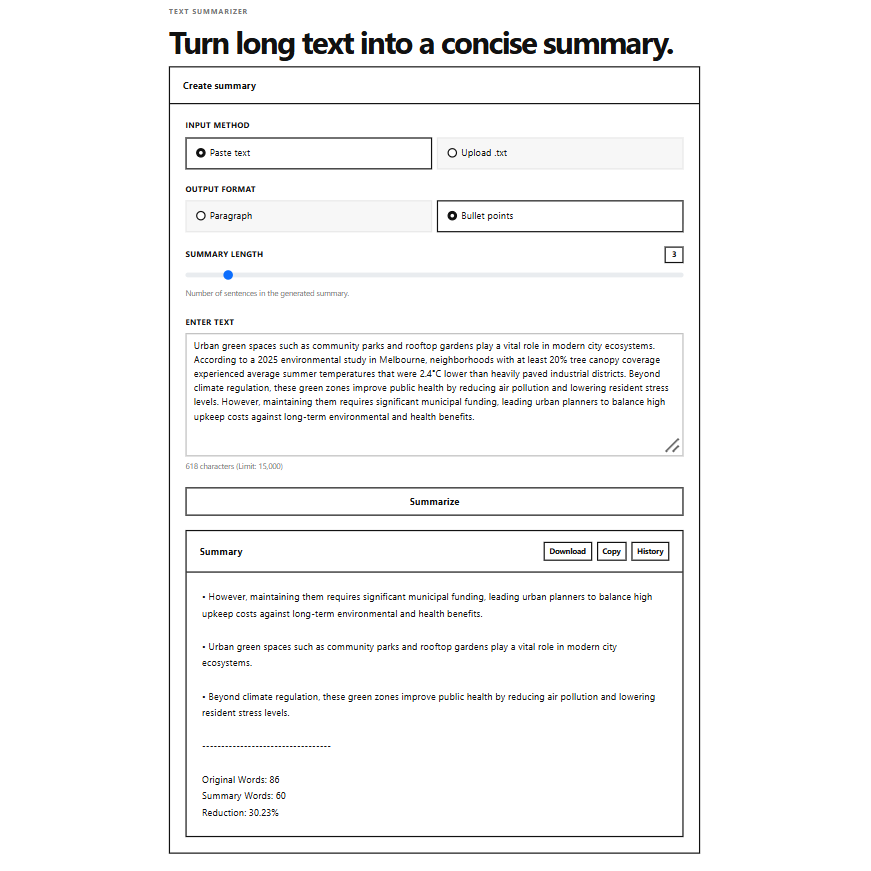

# Text Summarizer

Problem Statement: Long documents, articles, or text files require significant time and effort to read completely to extract key takeaways. Users often need the core ideas extracted rapidly without losing critical context. Standard text usually lacks customizable brevity options (such as specific sentence counts or concise bullet points vs. full paragraphs) for quick reading or reference.

Solution: It extracting the core idea from long text efficiently using intelligent sentence scoring and optional file upload support. It include features like Extractive Text Summarization (NLTK-based), Adjustable Summary Length (2–15 sentences), Paragraph or Bullet Point Output, Upload .txt File Support (up to 1MB), Auto-trimming for large content (15,000 characters limit), Word Count & Reduction Percentage Metrics, Download Summary as .txt, Copy to Clipboard and Summary History (last 5 summaries).



## Tech Stack
- Frontend: HTML5, CSS3, JavaScript, Bootstrap 5
- Backend: Python, Flask, NLTK (Natural Language Toolkit)

## Working
The application uses an extractive summarization approach:
- Tokenizes text into sentences and words.
- Removes stopwords and punctuation.
- Scores sentences based on word frequency.
- Selects top N highest-scoring sentences.
- Formats output as paragraph or bullet points.

## Future Improvements
- PDF file support
- Authentication & user accounts
- Database-based summary storage

## Setup Installation
```
git clone https://github.com/ujjwalkumar14b/Text_Summarizer.git
cd Text_Summarizer
```

## Author
Ujjwal Kumar
GitHub: [https://github.com/ujjwalkumar14b](https://github.com/ujjwalkumar14b)
